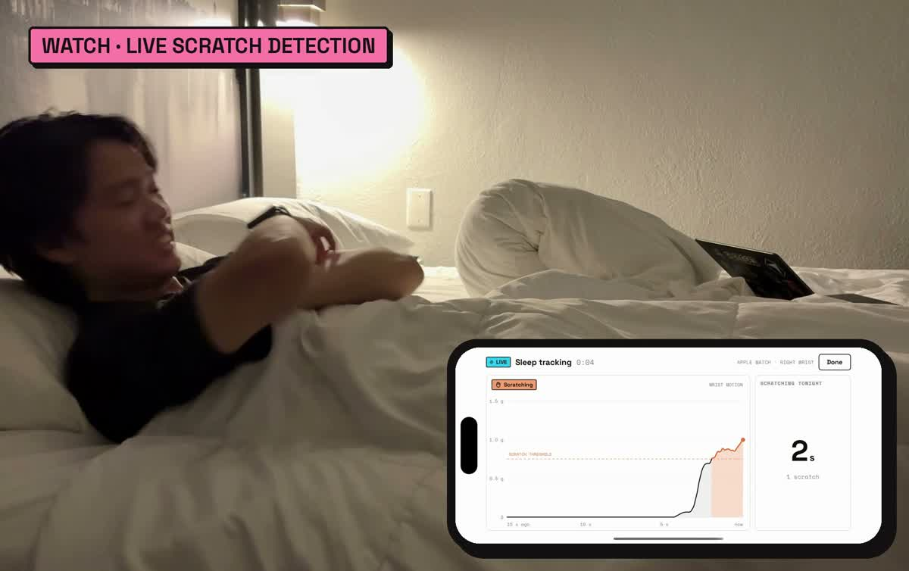
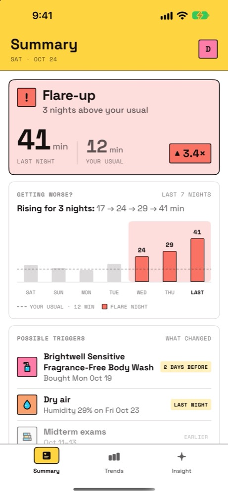
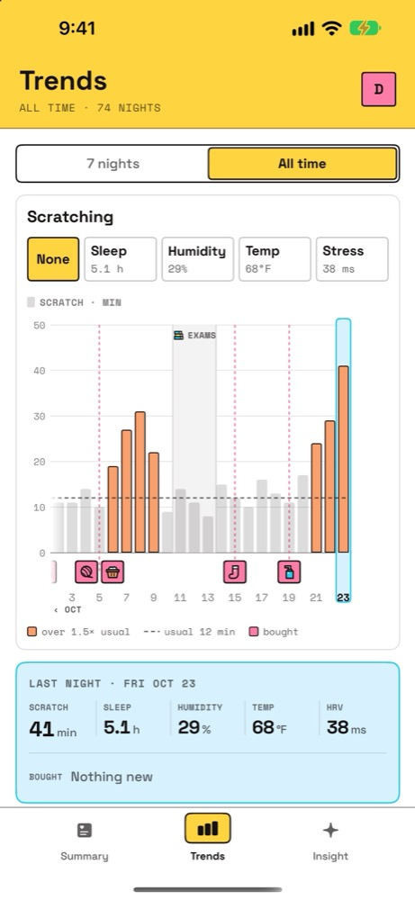
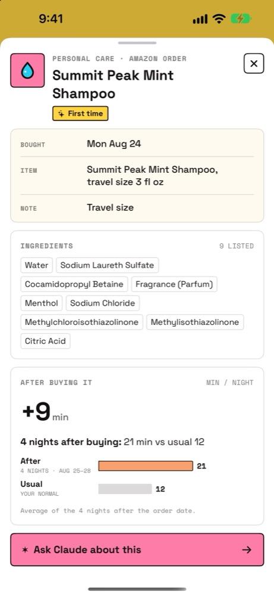
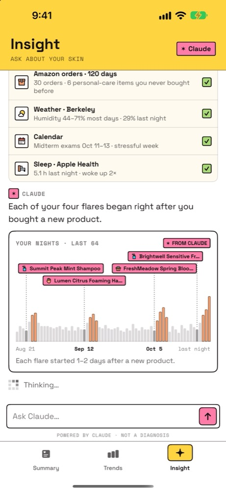
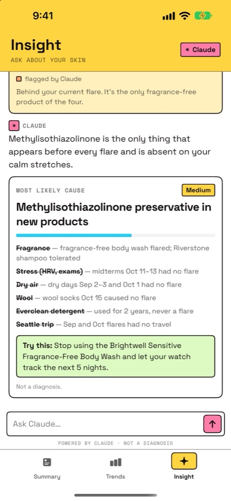
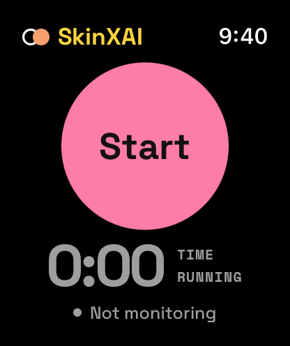

# SkinXAI

**Making Skin Great Again.** An Apple Watch + iPhone app that uses AI to find your personal eczema triggers.

Built at **Cal Hacks 13.0** (October 2026) · [Devpost](https://devpost.com/software/skinxai)

## Demo

https://github.com/user-attachments/assets/89bdd6bd-059b-4931-928e-b351fb59be68

Also on [YouTube](https://www.youtube.com/watch?v=1gewQwKMbPc).

## Problem

Over 200 million people live with eczema, and triggers are different for everyone: one person reacts to a chemical in a soap, another to stress. Finding your own triggers is the key to treatment, but most scratching happens while you sleep, and nobody keeps a diary at 3 a.m.

## Solution

| | |
|---|---|
| **Apple Watch** | Wear it to bed. It measures how much you scratch from wrist motion. Nothing to log. |
| **Trends** | Scratch minutes per night on one timeline, unusual spikes in orange, with sleep, humidity, temperature and stress overlaid. Tap a product to see its ingredients. |
| **Insight (Claude)** | Claude gathers your data with tools, finds what changed before each flare, asks a few questions to rule things out, and names the most likely trigger plus a simple test to confirm it. |

SkinXAI never diagnoses. It finds patterns in your own data and suggests confirming with a dermatologist.



| Summary | Trends | Product ingredients |
|---|---|---|
|  |  |  |

| Claude: what changed | Claude: conclusion | Watch |
|---|---|---|
|  |  |  |

## How it works

```
Apple Watch ──(50 Hz motion)──> scratch detector ──> scratch episodes
     │
     └──(live stream)──> Cloudflare Worker + Durable Object ──> iPhone / big screen

iPhone app ──(conversation + tools)──> Worker /api/chat ──> Claude Opus 5.5
           ──(order history)─────────> Worker /api/orders ──> Capital One Nessie API
```

- **Scratch detection (watchOS):** reads the accelerometer at 50 Hz and scores 3-second windows every 0.5 s for the fast back-and-forth motion of scratching (rate, strength, rhythm).
- **Data sources:** sleep and stress (HRV) from the Apple Watch, temperature and humidity from location, and purchases from card transactions via **Capital One's Nessie API**, joined with each product's ingredient list.
- **Claude agent:** its tools read scratch history, purchases with ingredients, weather, calendar and sleep; other tools draw on screen (mark the timeline, show a product card, ask a multiple-choice question, show the conclusion). It gathers data first, rules causes out one at a time, and only uses facts the tools returned.
- **Capital One Nessie:** implemented and tested against the live Nessie API (see [`app/Integrations/nessie`](app/Integrations/nessie)); the stage demo uses the built-in copy of the same 30 purchases.

## Repo layout

| Path | What |
|---|---|
| [`app/`](app/) | iPhone + Apple Watch app (SwiftUI). See [app/README.md](app/README.md). |
| [`app/Integrations/nessie`](app/Integrations/nessie) | Capital One Nessie integration (seed + read purchases, tested sample output). |
| `worker/` | Cloudflare Worker + Durable Object: live relay, `/api/chat` (Claude), `/api/orders` (Nessie). |
| `web/` | Big-screen web view (live scratch monitor, last night, history, Claude). |

## Run it

**App** (Xcode 26+, [XcodeGen](https://github.com/yonaskolb/XcodeGen)):
```bash
cd app && xcodegen generate && open EczemaTwin.xcodeproj
```
Run the `EczemaTwin` scheme (it includes the watch app). Demo data works offline.

**Server** ([Wrangler](https://developers.cloudflare.com/workers/wrangler/)):
```bash
wrangler secret put OPENROUTER_KEY
wrangler secret put INGEST_KEY      # the watch uses this to post data
wrangler dev                         # or: wrangler deploy
```


## Team

Jacky Zhong and Douglas Chen, University of British Columbia.
