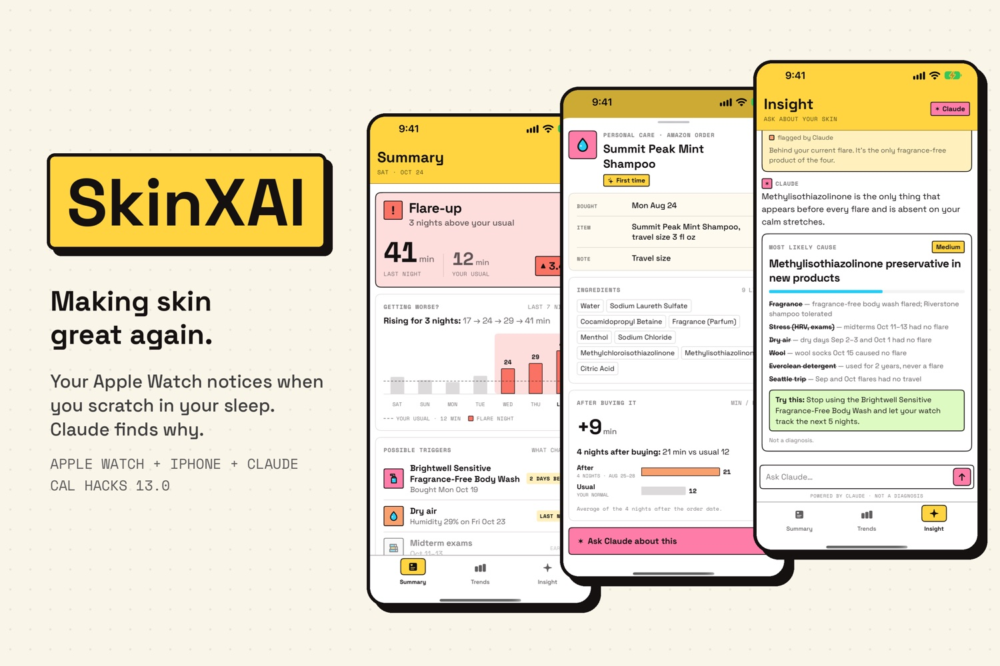
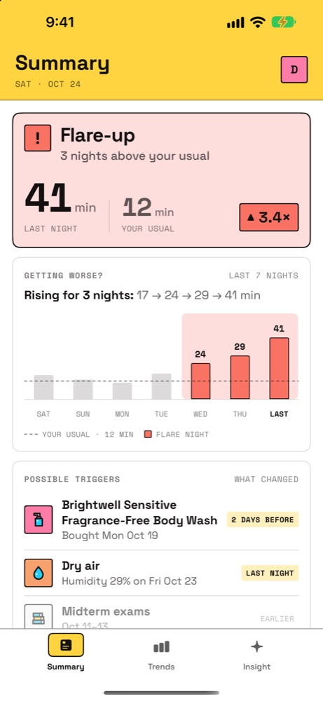
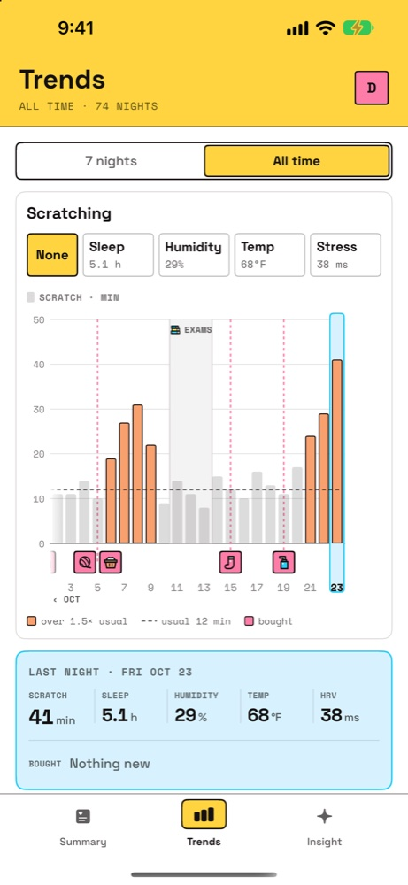
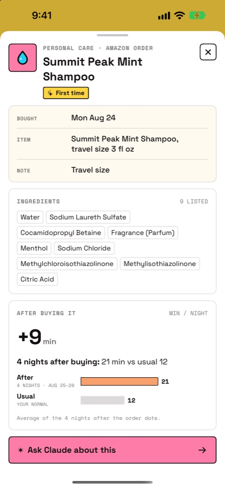
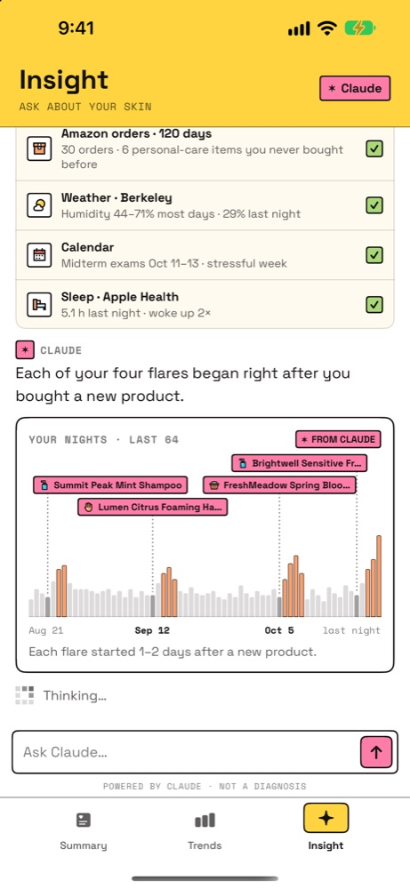
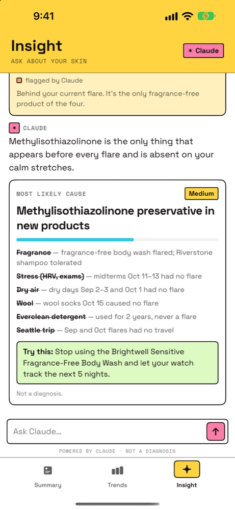
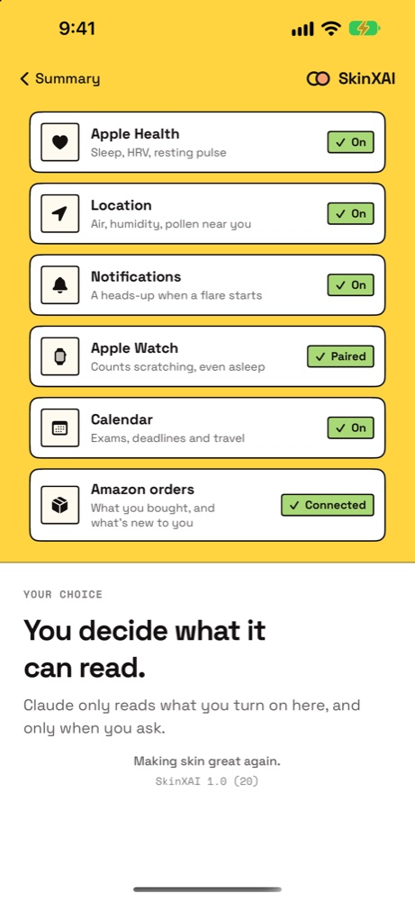
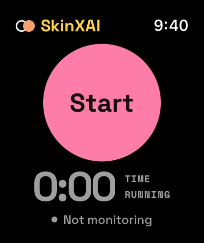

# SkinXAI

**Making skin great again.**

Your Apple Watch notices when you scratch in your sleep. Claude finds what is making your eczema flare.

Built at **Cal Hacks 13.0** (October 2026).



## The problem

Most eczema scratching happens while you sleep, so you don't know how bad last night was. Finding the trigger (a new soap, dry air, stress) usually means keeping a diary, and almost nobody does.

## What SkinXAI does

| | |
|---|---|
| **Apple Watch** | Wear it to bed. It measures how many minutes you scratch. Nothing to log. |
| **Summary** | Each morning: was last night normal for you, and what changed in the days before. |
| **Trends** | Every night on one timeline, with sleep, humidity, temperature and stress next to the scratching. Tap a new product to see its ingredients. |
| **Insight (Claude)** | Claude gathers your data with tools, marks the suspicious changes, asks a few questions to rule other causes out, and ends with the most likely trigger, what it ruled out, and a simple test to confirm it. |

SkinXAI never gives a diagnosis. It looks for patterns in your own data and suggests confirming with a dermatologist.

## Screenshots

| Summary | Trends | New product |
|---|---|---|
|  |  |  |

| Claude: timeline | Claude: conclusion | Permissions |
|---|---|---|
|  |  |  |



## How it works

```
Apple Watch ──(50 Hz motion)──> scratch detector ──> episodes
     │
     └──(live stream)──> Cloudflare Worker + Durable Object ──> iPhone / big screen
                                     │
iPhone app ──(conversation + tools)──┴──> Claude Opus 5.5
```

- **Scratch detection (watchOS):** reads the accelerometer at 50 Hz. A detector scores 3-second windows every 0.5 s for the fast back-and-forth motion of scratching (rate, strength, rhythm) and groups them into episodes.
- **Live relay:** a Cloudflare Worker with a Durable Object streams the watch data to the phone and to a big-screen web view in real time.
- **Claude agent:** tools read scratch history, orders with ingredient lists, weather, calendar and sleep/HRV. Other tools draw on screen: mark the timeline, show a product card, ask a multiple-choice question, show the conclusion. The instructions make Claude gather data first, rule causes out one at a time, and use only facts the tools returned.


## Run it

Requirements: Xcode 26+, [XcodeGen](https://github.com/yonaskolb/XcodeGen), an iPhone and Apple Watch (or simulators).

```bash
xcodegen generate
open EczemaTwin.xcodeproj
```

Run the `EczemaTwin` scheme (it embeds the watch app). Demo data works offline. For live streaming, create `App/Watch/Secrets.xcconfig` with `TWIN_LIVE_HOST` and `TWIN_LIVE_KEY` (not committed).

## Repo layout

| Path | What |
|---|---|
| `App/iOS` | iPhone app (SwiftUI): Summary, Trends, Insight |
| `App/Watch` | Watch app and scratch detector |
| `Packages/EczemaKit` | Data models and the demo dataset |
| `Shared` | Design system and fonts |
| `scripts` | Build and screenshot scripts |
| `SPEC.md` | Product and design spec |

## Team

Jacky Zhong and Douglas Chen (University of British Columbia).
